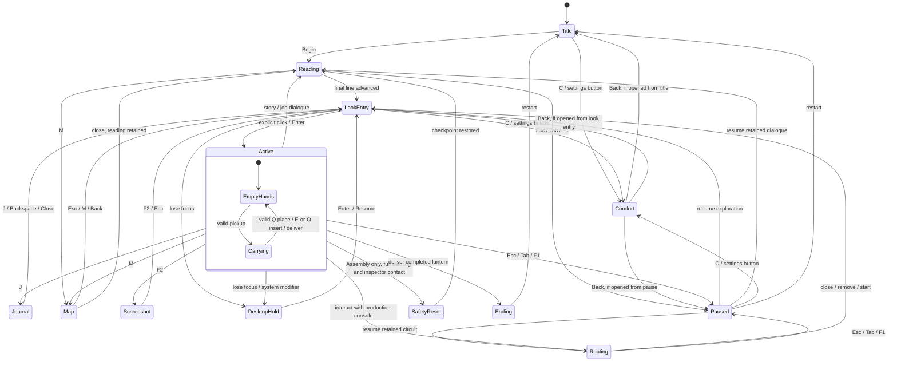
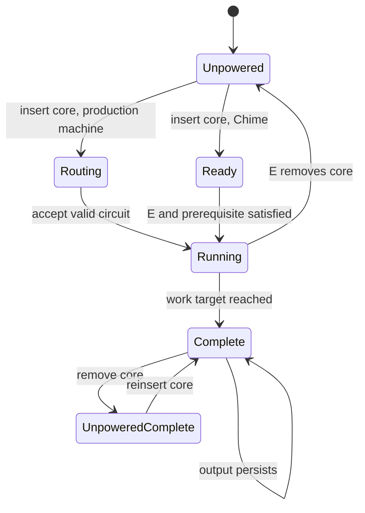

# Finite State Machines / implemented baseline

These diagrams describe current states and transitions. They are design documentation, not engine-generated verification. Parameters and exceptions are listed in GameScript.md.

## Player modes

The diagram shows the default mouse-look mode. Only explicit entry captures the pointer. All other modes shown have a free pointer; returning from any interruption cannot capture it automatically. LookEntry freezes simulation and is excluded from active-play time. Closing nested interfaces preserves the underlying dialogue, circuit and carrying state. In the explicitly selected free-pointer/right-drag or arrow-only alternative, exploration returns directly to Active without LookEntry. A safety reset preserves completed jobs. There is no death state.

## Inspector

```mermaid
stateDiagram-v2
    [*] --> Patrol
    Patrol --> Investigate: valid machine-start sound
    Return --> Investigate: valid machine-start sound
    Search --> Investigate: valid machine-start sound
    Investigate --> Return: finish visit; archive chime holds 16 seconds
    Patrol --> Alert: Assembly, player visible
    Investigate --> Alert: Assembly, player visible
    Return --> Alert: Assembly, player visible
    Search --> Alert: Assembly, player visible
    Alert --> Approach: Assembly visibility fills alert over 1.6 seconds
    Alert --> Search: lose line of sight
    Approach --> Search: lose line of sight
    Search --> Return: 4 seconds elapsed
    Return --> Patrol: reach patrol waypoint
    Approach --> Patrol: contact causes safety reset
```

The archive is SafePractice: Alert/Approach are cancelled, no contact reset is allowed, and a chime visit lasts 16 game seconds even after core removal. The player does not need to wait. Only the announced Assembly duty enables the Alert/Approach transitions. New machine sound cannot override Alert or Approach. Visibility requires range, field of view, region bounds and an unblocked ray. A crate is occlusion only when placed, since held objects have colliders disabled.

## Machine

Partial work survives power removal. The workshop relay is a continuous power source for its gate, not a completed-work flag. A manual crate plate can take over while its core is reused elsewhere.

## Helper presentation (v0.4)

Button and Pip: Idle → WelcomeWave on first nearby active encounter; Idle/WelcomeWave → Celebrate on manufacturing success or optional Button interaction; animations return to Idle after their timers. Body bob, sleeve gestures and gaze use the same paused world clock. When Ended becomes true, helper relocation and gaze stop and EndOfShift controls the group departure. This helper presentation does not replace Hush's patrol FSM.

Overlay modes retain the underlying dialogue, circuit, journal, pause and carrying state. Closing the map or screenshot view returns to that retained mode, not necessarily Active. The diagram shows representative transitions rather than every overlay combination.

v0.11 leaves the mode transitions unchanged. R levels pitch without changing the current mode or yaw. A core inserted by either E or Q uses the same Carrying → EmptyHands → Routing path as E insertion. DesktopHold displays only its paused interface, with no active E/Q coach.
