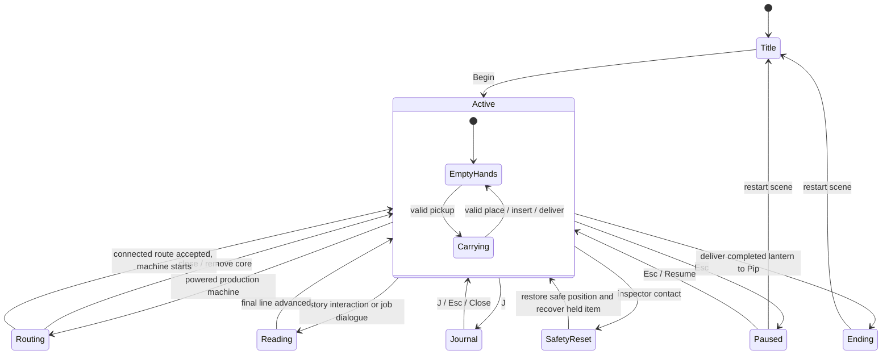
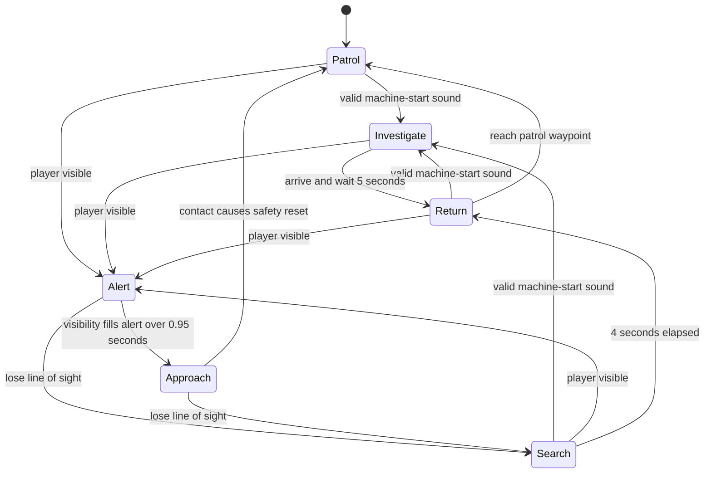
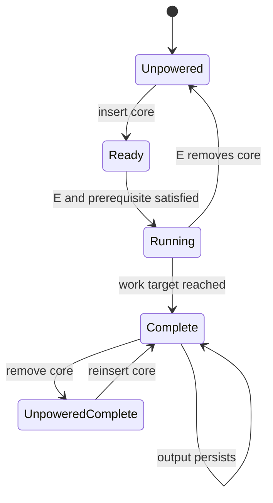

# Finite State Machines / implemented baseline

These diagrams describe current states and transitions. They are design documentation, not engine-generated verification. Parameters and exceptions are listed in GameScript.md.

## Player modes

Movement can coexist with both carrying states. Reading, Journal, Routing and Paused retain the previous carrying state and freeze world simulation. A safety reset returns held items to known home positions and preserves completed jobs. There is no player death state.

## Inspector

A new machine sound cannot override Alert or Approach. Visibility requires range, field of view, region bounds and an unblocked ray. A crate is occlusion only when placed, since held objects have colliders disabled.

## Machine

Partial work survives power removal. The workshop relay is a continuous power source for its gate, not a completed-work flag. A manual crate plate can take over while its core is reused elsewhere.

## Helper presentation (v0.4)

Button and Pip: Idle → WelcomeWave on first nearby active encounter; Idle/WelcomeWave → Celebrate on manufacturing success or optional Button interaction; animations return to Idle after their timers. Body bob, sleeve gestures and gaze use the same paused world clock. When Ended becomes true, helper relocation and gaze stop and EndOfShift controls the group departure. This helper presentation does not replace Hush's patrol FSM.
