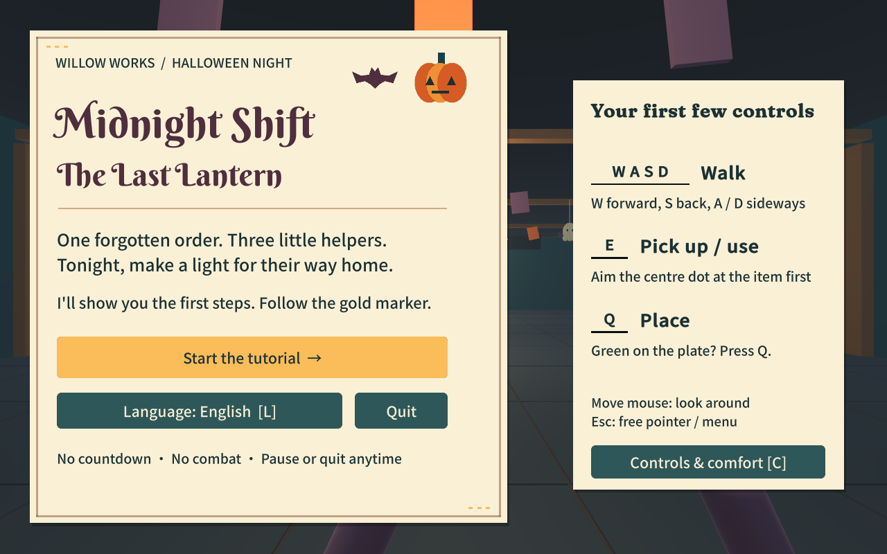
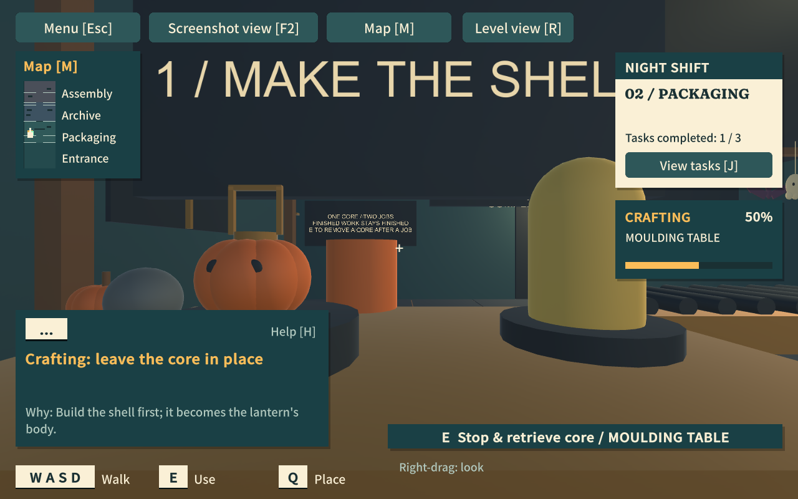

Midnight Shift The Last Lantern

Yu Han | CSCI 5999B Project 2 | October 16, 2026 | Version 0.15

## 1 High Concept and Story Background

I began with a story about returning to finish a childhood promise. I wanted the player to understand the meaning of a gift while making it, so I built the game around a warm Halloween toy factory and one unfinished pumpkin lantern.

As a child, the protagonist drew a lantern for the little helpers at Willow Works, who stayed after everyone else went home. The gift was left unfinished, but the helpers kept the drawing. Years later, the protagonist returns to the closing factory on Halloween and helps finish its last order. The player initially knows only that a lantern needs to be made.

Button's memories of the mould and crooked ribbon lead the player to the archive. There, the protagonist recognizes their own childhood handwriting: "For the last one to leave. So the way home is bright, too." The remaining work completes that promise. The player lights the lantern and gives it to Pip, the foreman. The helpers leave together for the Halloween parade.

This is a single-player, first-person 3D environmental puzzle game made in Unity. It is intended for players who enjoy exploration, approachable puzzles and character stories. A keyboard and mouse are required; controls and story context are introduced during play.

<!-- PAGE -->

## 2 Game Script and Rules

### Objects and production

WASD moves, the mouse turns the view, E picks up or uses objects, and Q places the held item. The player carries one object at a time. A valid placement preview shows where it will land. Blocked placements keep the item in hand and explain the problem. Esc releases the pointer and opens the menu; R levels the view, H opens help, J opens the notebook, M opens the map and F2 opens screenshot view.

A player or a placed crate can hold a pressure plate. Its door stays open while the plate is held. The workshop gate can also be powered by the gold core. Its override crate starts behind the gate: the player powers the gate, retrieves the crate, leaves it on the plate, then takes the core to production.

The factory has one reusable core. Near a valid console, E or Q inserts it. The production sequence is shell, ribbon, engraving and final pressing. Engraving requires the archive drawing. Each machine checks its prerequisite before accepting the core. Removing power stops current work while retaining progress; finished work remains complete. The Press creates one portable lantern. Delivering it to Pip completes the game.

### Circuits and the safety inspector

Clicking a circuit tile rotates it clockwise; arrows select a tile and Space rotates it. Power crosses between tiles when both touching edges connect. Every marked star contact and every right-edge outlet must receive power. Unused ends are allowed. Start machine or Enter accepts a valid board; Reset restores its initial rotations. Backspace or the return button closes it while preserving rotations. Remove core retrieves the power core.

Hush is a friendly safety inspector. Ringing the powered Chime calls him over for 16 game seconds, even after its core is removed. The archive is safe practice throughout. Final Assembly introduces the active safety check: sustained visibility fills a warning, and subsequent contact causes a local retry. Shelves and placed crates block sight. A retry preserves finished jobs, the drawing and crates holding access, recovers the core locally, and gives time to reorient.

### Modes and available actions

| Mode or screen | Available actions and world behavior |

| --- | --- |

| Exploration | Walk, look and interact, either empty-handed or carrying one item. The world is active. |

| Circuit and reading | Rotate and start a circuit, or advance dialogue. Both pause the world. Tutorial Complete uses a separate reading screen. |

| Map, notebook and screenshot | Inspect navigation, tasks, story or a clean view. The world pauses; closing restores the previous activity. |

| Look entry and desktop hold | The pointer is free and the world paused. Click or Enter deliberately resumes default mouse look. |

| Title, pause and settings | Start, resume, restart, quit, adjust sound and comfort, or choose a language. Settings preserve progress. |

| Ending | Watch the helpers leave, then restart or quit. |

<!-- PAGE -->

## 3 Level Design and Learning Objectives

One continuous factory scene contains a short foyer tutorial, Packaging, the Archive, Final Assembly and delivery. Crossing the foyer door leads to an explicit Tutorial Complete screen. The player then confirms the start of the night shift. Later areas introduce new rules as they become relevant.

I used the first crate to teach a sustained condition: a door needs its plate held while the player moves elsewhere. Packaging changes the problem by placing the only core in competition with access. A crate takes over the gate condition, freeing the core for a machine. Final Assembly combines access planning with the same shared resource.

The four circuit puzzles increase the decisions required. Moulding introduces rotation, one outlet and one star contact. Ribbon adds a second outlet and a branching connection. Engraving requires a route through two contacts. The Press combines two outlets with two contacts. The archive safely introduces sound investigation before the announced Assembly check adds movement timing and cover.

The required progression teaches resource sequencing, the difference between a maintained condition and a retained result, and reciprocal circuit connections. Patrol observation, sound and placed-crate cover offer additional ways to plan movement. The final task brings the earlier rules together in one production goal.

The manufacturing stages give each solved puzzle a visible result. The player can see the shell, ribbon, inscription and light accumulate, while the notebook keeps the next task and core location available.

<!-- PAGE -->

## 4 Story Audio and Visual Design

I placed the story clues inside the production sequence. Button remembers the old mould and the child's deliberately crooked ribbon. Reading the drawing identifies the recipient before engraving and assembly. This gives the final work a personal purpose. Delivery remains a player action: the completed lantern must be carried to Pip.

The original synthesized music uses a music-box melody with additional accompaniment as work progresses. Footsteps and interaction sounds support movement, while circuit success, machine starts, production loops, the Chime and safety warnings identify events. Crafting sound and the progress bar follow actual work. Audio settings provide volume adjustment and a sound test.

Pumpkins, paper bats, autumn colors, small magical helpers and the parade establish Halloween throughout the factory. Decorative typography is concentrated in the title; instructions use readable text and keycaps. Characters float, turn, wave, celebrate and leave through the doorway in sequence.

## 5 Design Schemas

### Games as Systems of Information

This schema examines how players obtain and interpret information to choose actions. I applied it to the information needed for each decision: the notebook locates the core, machine prompts state prerequisites, the circuit shows powered connections and contact counts, and Hush's warning makes risk visible.

For example, a lit outlet does not complete a board if a required star remains unpowered. The player reads both kinds of feedback to judge the circuit. The archive drawing supplies narrative information: the same lantern-making task gains a different meaning when the player discovers its intended recipients.

### Games as Systems of Uncertainty

This schema examines what players do not yet know and how play lets them resolve it. The player begins without knowing the circuit solutions, the order for sharing power or the safe timing of movement. Trying a rotation, observing a patrol and seeing a machine retain its output inform the next decision. Consistent rules allow the player to revise a plan.

I separated these demands during teaching. Circuit solving pauses the world, and the archive introduces Hush without a retry penalty. Final Assembly then combines known rules with the safety check. The sequence lets the player build understanding before handling several conditions together.

These applications follow the course discussions of Systems of Uncertainty and Systems of Information in Rules of Play. The learning objectives also follow the Fundamentals of Game Design guidance by naming the specific decisions exercised in play.

<!-- PAGE -->

## 6 Finite State Machines and Animation

The player uses a hierarchical finite state machine. Active exploration contains Empty Hands and Carrying; looking and walking are available in both. Information interfaces retain the underlying item and task state.

| Current state | Trigger and next state |

| --- | --- |

| Title | Start opens welcome Reading. Finishing it enters Look Entry. |

| Look Entry | An explicit click or Enter captures the mouse and enters Active exploration. Alternative free-pointer controls return directly to Active. |

| Active Empty Hands | A valid pickup enters Carrying. |

| Active Carrying | Valid placement, core insertion or delivery clears the hands. An invalid action retains the item. |

| Active exploration | Using a production console enters Routing. Story interactions enter Reading. First foyer crossing opens Tutorial Complete. |

| Routing or Reading | Start, return or the final Continue restores exploration. Accepted circuits begin production. Tutorial confirmation begins the night shift. |

| Active or an interface | Map, notebook, screenshot or pause opens the corresponding overlay. Closing restores the retained activity; exploration uses Look Entry. |

| Active or Look Entry | Focus loss or a desktop shortcut enters Desktop Hold. Resume returns to Look Entry. Settings return to their parent screen. |

| Active exploration | Full Assembly warning plus contact enters Safety Reset, then a paused explanation. Finished work remains saved. |

| Carrying the lantern | Delivery to Pip enters Ending. Restart reloads Title; Quit exits. |

### Hush behavior

| Transition | Condition |

| --- | --- |

| Patrol / Search / Return to Investigate | A valid machine sound occurs in Hush's duty area. |

| Investigate to Return to Patrol | The visit finishes, then Hush reaches his patrol route. The archive Chime visit lasts 16 seconds. |

| Patrol / Investigate / Search / Return to Alert | The player is visible during Assembly duty. |

| Alert to Approach | Continued visibility fills the warning over 1.6 seconds. |

| Alert / Approach to Search | Line of sight is lost. After four seconds, Search enters Return. |

| Approach to local retry and Patrol | Contact follows a full warning. Recovery grants five seconds of grace. |

Archive practice suppresses Alert and Approach. New sounds cannot cancel an active warning. Pip and Button move between Idle, Welcome Wave and Celebrate, returning to Idle after each gesture. Ending activates their departure animation. Machines move from Unpowered through Routing and Running to Complete; removing the core retains progress and finished output.

<!-- PAGE -->

## 7 Playtesting and Iteration

Playtesting showed that first-person controls, navigation and object rules needed clearer communication. I used the following feedback to change how the existing game was taught and operated.

| Player feedback | Revision and purpose |

| --- | --- |

| Turning was hard to discover; the mouse interfered with desktop actions. | Taught mouse look explicitly, released the pointer on Esc and interruptions, and added comfort settings and alternative controls. |

| Text was small and the next action was unclear. | Enlarged text and keycaps, emphasized one current action, and kept the full checklist in the notebook. |

| Core pickup and insertion were difficult; placement targets were unclear. | Improved reachable-object selection, core insertion and placement previews. Added illuminated target plates. |

| Players circled near the archive; the route appeared unstable. | Added an expandable map and stable ground guidance through walkable passages. |

| Hush caused confusing returns during apparent teaching. | Made the archive safe practice and moved the explained safety challenge to Final Assembly. |

| The tutorial boundary and reasons for tasks were unclear; feedback was weak. | Added Tutorial Complete, explicit phase labels and Why text, plus success cues, machine sounds and crafting progress. Corrected helper spacing and departure. |

My first completed run took about 20 minutes. After an update, a friend reported about 13 minutes. Another friend completed the final v0.15 in about 10 minutes. These are approximate reports from different players and versions. The latest report reaches the upper end of the rubric's 5-10-minute range.

The Git history preserves these revisions, including commits 7cfdce1, 2d18a15, 986bbd8 and fc16ac7. PLAYTEST.md and ITERATIONS.md preserve the detailed feedback, reasons for changes and checks.

## 8 Final Version and Submission

Version 0.15 provides Windows x86-64, Mac and Linux x86-64 releases. English is the default, with six additional language options. Mac gameplay was inspected; Windows and Linux packages passed native startup checks. The source, iteration history and release files are available through the repository below.

The three platform archives are prepared for Box; this report and the repository link form the Blackboard submission. Instructor cwwalterOleMiss has been invited as a collaborator.

Repository: [https://github.com/yhan3-ctrl/midnight-shift](https://github.com/yhan3-ctrl/midnight-shift)

Release: [https://github.com/yhan3-ctrl/midnight-shift/releases/tag/v0.15](https://github.com/yhan3-ctrl/midnight-shift/releases/tag/v0.15)

### References and credits

Course materials: CSCI 5499B/5999B Project 2 assignment; Fundamentals of Game Design, slides 21-23, 47 and 54-55; Rules of Play, slides 68-84 and 86-95.

Geometry, story, procedural animation and synthesized audio were created for this project. Fraunces, Noto and Berkshire Swash fonts use SIL OFL 1.1. Sources and licenses appear in Documentation/CREDITS.md.